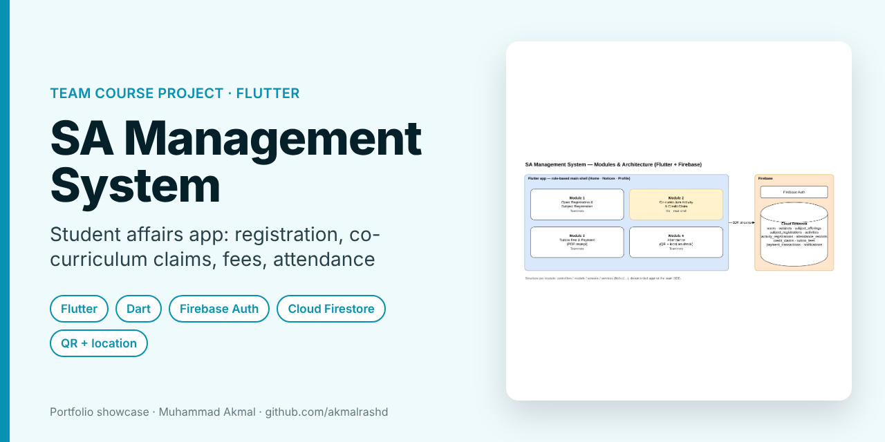
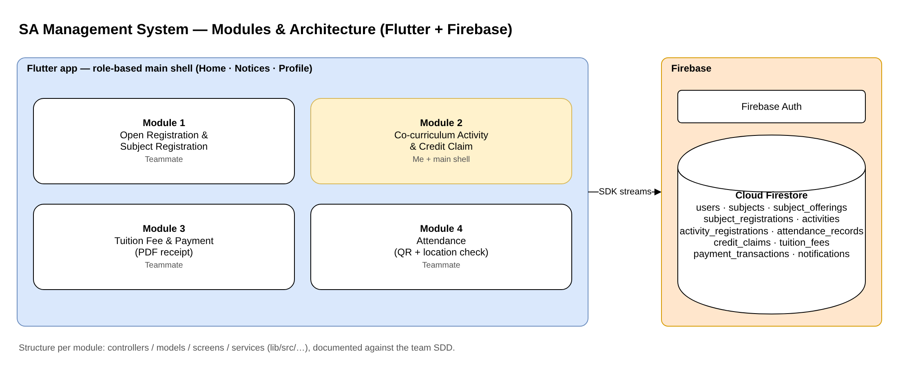
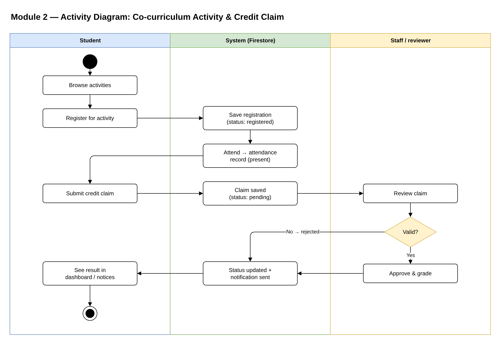

# SA Management System: Flutter App

> **Portfolio showcase** of a team course project (3 developers). I built **Module 2: Co-curriculum Activity & Credit Claim** and the role-based main shell.

**Type:** Team course project, UMPSA · **Period:** April – June 2026 · **My commits:** 23 of 36

  

---

## What it is

A student-affairs app with four modules: subject registration, co-curriculum activities and credit claims, tuition fee payment with PDF receipts, and attendance using QR codes and a location check. Each teammate owned one module, structured the same way (controllers, models, screens, services) and documented against the team's Software Design Document (SDD).

## My part

- **Co-curriculum module:** activity list and registration, attendance records, credit-claim submission, staff review and grading, and notifications back to the student.
- **Main shell:** login, role-gated home grid, notices streamed from Firestore (each notice opens the related module), profile page, logout.
- SDD traceability comments in the code (requirement IDs), plus merging feature branches into `main`.

## System design

### Modules and architecture

### Activity diagram: co-curriculum claim (my module)

## Contact

**Muhammad Akmal bin Mohd Rashid**: Software Engineering student, UMPSA.  
Open to a 6-month internship (22 February to 7 August 2027).  
📧 work.akmalrashd@gmail.com · 💼 [linkedin.com/in/akmalrashd](https://www.linkedin.com/in/akmalrashd)
